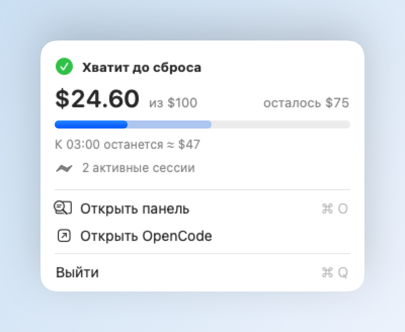
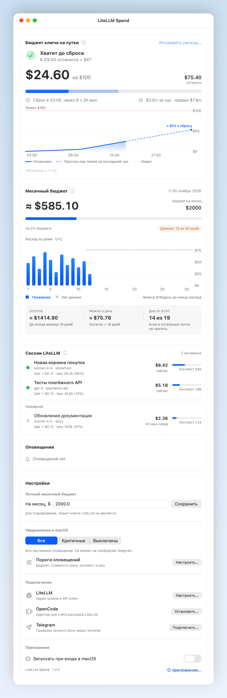

# LiteLLM Spend

macOS-приложение для контроля расходов LiteLLM: бюджет ключа, стоимость
сессий, контекст, кеш и критические алерты. В одном проекте находятся нативная
панель, ядро мониторинга, адаптер OpenCode и подключение собственного Telegram-бота.

Общего сервера и общего бота нет. Подключите свой шлюз и ключ.

## Скриншоты

Все данные на изображениях вымышленные: лимит ключа — **$100 в день**,
месячный бюджет — **$2000**. Названия проектов, сессии и расходы демонстрационные.

### Маленькая панель

<picture>
  <source media="(prefers-color-scheme: dark)" srcset="docs/screenshots/litellm-spend-compact-dark.png">
  
</picture>

### Полная панель

<details>
<summary>Показать бюджет, графики, сессии и настройки</summary>

<picture>
  <source media="(prefers-color-scheme: dark)" srcset="docs/screenshots/litellm-spend-full-dark.png">
  
</picture>

</details>

Оригиналы PNG: [маленькая — светлая](docs/screenshots/litellm-spend-compact-light.png)
и [тёмная](docs/screenshots/litellm-spend-compact-dark.png);
[полная — светлая](docs/screenshots/litellm-spend-full-light.png)
и [тёмная](docs/screenshots/litellm-spend-full-dark.png).

## Собрать приложение

Нужны macOS, Xcode Command Line Tools и Bun **1.3.12**.
Локальная сборка проверяется на Apple Silicon; Intel отдельно
не проверен. Минимальная версия в manifest приложения — macOS 13.

```sh
bun install --frozen-lockfile
bun run check
bun run build
bun run smoke
```

Результат: `desktop/build.noindex/LiteLLM Spend.app`. Внутри находятся панель,
runtime Bun, CLI и исходники адаптера. Установленный Bun для запуска готовой
`.app` не нужен. Приложение работает из своей папки и не зависит от checkout.

Автоматические проверки не покрывают интерактивные окна, привязку Telegram,
автозапуск и установку адаптера в рабочий OpenCode.

Сборка **не заменяет** установленную панель и отказывается перезаписывать готовую
`.app`. Для повторной сборки укажите новый путь:

```sh
bash desktop/build.sh "$PWD/desktop/build.noindex/LiteLLM Spend Next.app"
bun desktop/smoke.ts "$PWD/desktop/build.noindex/LiteLLM Spend Next.app"
```

Подпись локальная, ad hoc; notarization и публичного распространения нет.
Для установки перенесите проверенную `.app` в `~/Applications`, сохранив прежнюю
версию отдельно. Не запускайте старую и новую панель одновременно.

## Подключить

1. Откройте `.app`. Она показывает панель и значок в строке меню.
2. Внизу панели откройте **«Настройки» → «Подключения» → «LiteLLM»**: укажите адрес своего шлюза.
   Новый ключ вводится в скрытое поле; пустое поле сохраняет текущий ключ.
   Если адаптер уже работает, новый адрес и ключ применятся при следующем
   запуске службы OpenCode. Не перезапускайте её во время работы агента.
3. В той же группе нажмите **«Установить…»** напротив OpenCode и подтвердите обновление.
   Установщик сохраняет конфиг и пользовательские файлы, а прежнюю папку —
   в скрытом соседнем каталоге `.litellm-spend-backup.*/previous`.
   Служба OpenCode не перезапускается.
4. При необходимости нажмите **«Подключить…»** напротив Telegram. В Terminal откроется
   локальный мастер со скрытым вводом токена и подтверждением владельца.
   До установки фоновой службы поместите `.app` в постоянную папку:
   служба ссылается на runtime внутри приложения.

Расход и лимит ключа берутся из заголовков ответов агентов, без проверочных запросов
к моделям. Данные появятся после наблюдённого ответа LiteLLM. Цены и лимиты
моделей загружаются отдельно через `/v1/model/info`.

При отрицательном счётчике включается локальная оценка до конца UTC-дня.
Через **«Исправить расход…»** можно задать сверенный итог дня из usage LiteLLM;
новые наблюдённые шаги прибавляются к нему. Локальный учёт не видит пропущенных
запросов и других клиентов. Месячный бюджет настраивается отдельно от лимита ключа.

## Уже установлен прежний плагин

Приложение использует существующий
`~/.config/opencode/plugins/litellm-spend/config.json` и заданный в нём `storage.dir`.
При первом запуске без конфига копируется только безопасный шаблон.
Ключи, история сессий и Telegram-привязка не копируются в `.app` или репозиторий.

Пути конфига и данных, а также bundle identifier сохранены для совместимости. Telegram продолжает
работать отдельным LaunchAgent. Запуск панели не устанавливает и не заменяет его.
Если он уже работает, повторная привязка не нужна.

По кнопке **«Алерты»** Telegram показывает до десяти последних критических событий.
Флаг `enabled: false` в `<storage.dir>/telegram/state.json` выключает автоматическую
отправку, но не ответы на кнопки. Запуск панели и установка адаптера этот флаг
не меняют. Мастер подключения Telegram при замене привязки создаёт новое
состояние с включёнными критическими автоуведомлениями. Чтобы сохранить ручной
режим, не заменяйте действующую привязку.

## CLI и устройство проекта

В готовой `.app` доступен CLI:

```sh
"desktop/build.noindex/LiteLLM Spend.app/Contents/MacOS/litellm-spend" --help
```

- [Архитектура и проверки](docs/architecture.md)
- [Мониторинг, команды и Telegram](docs/monitor.md)
- [Правила для агентов](AGENTS.md)

Готовый адаптер есть только для OpenCode V2. Для других клиентов доступны
`ingest` и `ingest-key`; готовых интеграций Claude Code и Codex нет.
